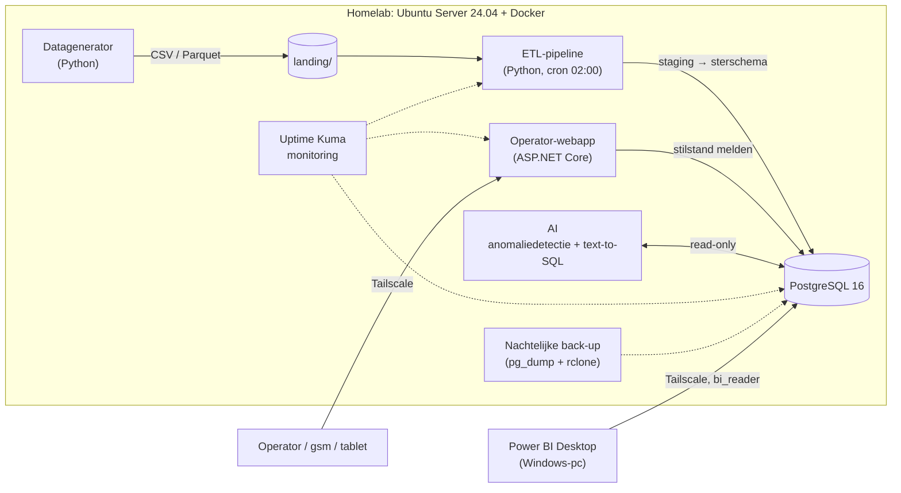

# data-platform-lab

Een end-to-end dataplatform voor een gesimuleerde staalfabriek ("SteelLine"), volledig zelf gebouwd en gehost op een eigen Linux-server.
Elke nacht wordt er realistische productie- en stilstanddata gegenereerd, gevalideerd en in een PostgreSQL-sterschema geladen. Daarop draaien een Power BI-dashboard, een C#-webapp voor operators en een AI-laag (anomaliedetectie en een vraag-je-data-chatbot).

> Work in progress. Dit project wordt in fases opgebouwd (zie [Roadmap](#roadmap)).

## Geplande architectuur



Alle toegang van buitenaf loopt via **Tailscale**; de database staat niet open naar het internet.

## Tech stack

| Laag | Technologie |
| --- | --- |
| Server | Ubuntu Server 24.04 LTS, Docker Compose, Tailscale, ufw |
| Database | PostgreSQL 16 (sterschema + staging-schema) |
| Data & ETL | Python 3.12, pandas, numpy, SQLAlchemy, psycopg, pytest |
| Rapportering | Power BI (DAX, OEE, MTBF/MTTR) |
| Webapp | C# / ASP.NET Core Razor Pages, EF Core (Npgsql), xUnit |
| AI | scikit-learn (IsolationForest), LLM-API (text-to-SQL), FastAPI |
| Operations | Uptime Kuma, cron / systemd-timers, pg_dump-back-ups |

## Mappenstructuur

```
data-platform-lab/
  infra/        docker-compose, back-upscripts, cron
  generator/    Python: fake fabrieksdata
  etl/          Python: laden in de database
  sql/          schema, views, migraties
  powerbi/      .pbix + screenshots
  webapp/       ASP.NET Core-app
  ai/           chatbot + anomaliedetectie
  docs/         architectuur, beslissingen
```

## Roadmap

- [ ] **Fase 0** – Voorbereiding: repo, werkomgeving, README
- [ ] **Fase 1** – Homelab: Linux-server, Docker, PostgreSQL, monitoring, back-ups
- [ ] **Fase 2** – Datagenerator, sterschema en nachtelijke ETL
- [ ] **Fase 3** – Power BI-dashboard (OEE, stilstand, kwaliteit)
- [ ] **Fase 4** – C#-webapp voor stilstandregistratie
- [ ] **Fase 5** – AI: anomaliedetectie en text-to-SQL-chatbot
- [ ] **Fase 6** – Afwerking, demovideo en documentatie
