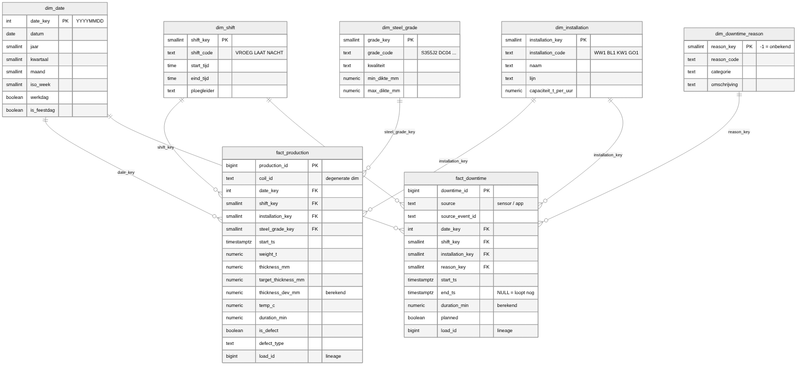
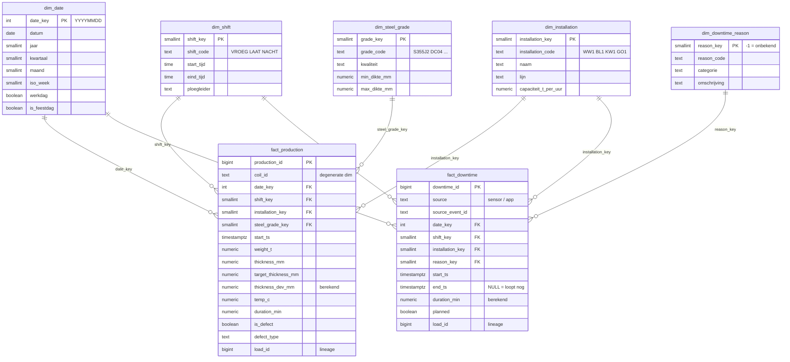
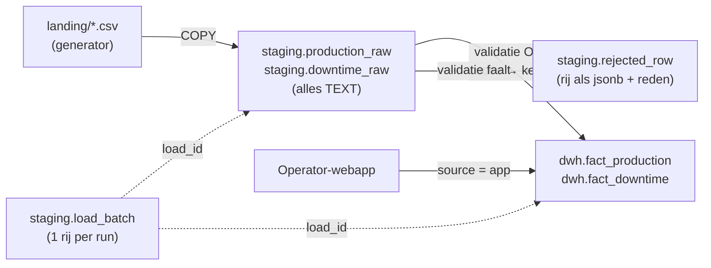

# Datamodel SteelLine

Sterschema in PostgreSQL (schema `dwh`) met een aparte landingszone (schema `staging`).
Bewerkbaar diagram: [`schema.dbml`](schema.dbml) → plakken in [dbdiagram.io](https://dbdiagram.io/d).
Bron van waarheid: [`sql/001_schema.sql`](../sql/001_schema.sql), [`002_staging.sql`](../sql/002_staging.sql), [`003_seed_dimensions.sql`](../sql/003_seed_dimensions.sql).



## Sterschema (`dwh`)



### Grain (wat is 1 rij?)

| Tabel | Grain | Unieke sleutel |
| --- | --- | --- |
| `fact_production` | 1 rol (coil) bewerkt op 1 installatie | `(coil_id, installation_key)` |
| `fact_downtime` | 1 stilstand van 1 installatie | `(source, source_event_id)` |

## Staging en datastroom



1. De ETL maakt een rij in `staging.load_batch` (status `bezig`) en krijgt een `load_id`.
2. `TRUNCATE` van de `*_raw`-tabellen, dan `COPY` van de CSV's. Alle kolommen zijn `text`,
   zodat één foute waarde de load niet laat crashen.
3. Validatie in SQL (week 5–7). Voorbeelden van regels:
   - types: getallen, datums en booleans zijn parsebaar;
   - referenties: `installatie_code`, `staalkwaliteit`, `ploeg`, `reden_code` bestaan in de dimensies;
   - business: dikte binnen `min/max_dikte_mm` van de kwaliteit, `end_ts > start_ts`, gewicht > 0,
     `defect_type` ingevuld als en alleen als `is_defect`.
4. Goede rijen → `INSERT ... ON CONFLICT DO UPDATE` in `dwh` (herhaalbaar: dezelfde dag opnieuw
   laden geeft geen dubbels). Foute rijen → `staging.rejected_row`.
5. `load_batch` krijgt status `geslaagd` / `deels` / `mislukt` en de tellingen → Uptime Kuma-push.

## Ontwerpbeslissingen

| Beslissing | Waarom |
| --- | --- |
| `date_key` = `YYYYMMDD` (int) | Leesbaar, sorteerbaar, ETL hoeft niets op te zoeken. Power BI markeert `dim_date` als datumtabel. |
| Surrogaatsleutels + aparte `*_code` | Bronnen kennen codes (`WW1`), het sterschema joint op kleine integers. Een code kan wijzigen zonder feiten te herschrijven. |
| Nachtploeg hoort bij de **startdatum** | Ploeg 22:00–06:00 op 12/11 telt volledig mee voor productiedag 12/11, ook wat na middernacht valt. Zo hoort elke ploeg bij precies één dag. |
| `coil_id` als degenerate dimension | Een rolnummer heeft geen eigen attributen; een aparte dimensie zou enkel een extra join zijn. |
| `duration_min` en `thickness_dev_mm` als generated columns | Kunnen nooit inconsistent worden met de bronkolommen. |
| `reason_key = -1` ("onbekend") | Operator meldt een stilstand vaak vóór de oorzaak gekend is; geen `NULL`-FK's in het feit. |
| `end_ts` mag `NULL` | Lopende stilstand vanuit de webapp; partiële index `ix_fd_open` vindt die snel. |
| SCD type 1 op dimensies | Nieuwe ploegleider of capaciteit overschrijft de oude waarde. Voor dit project voldoende; type 2 is een mogelijke uitbreiding. |
| Indexen op elke FK in de feiten | PostgreSQL maakt die niet automatisch; nodig voor joins en filters vanuit Power BI. |
| `load_id` in de feiten, zonder FK naar staging | Lineage (welke run laadde deze rij, foute run terugdraaien) zonder dat `dwh` afhangt van staging. |
| Staging alles `text` | Validatie gebeurt gecontroleerd in SQL met een reden per afgekeurde rij, in plaats van een crash bij `COPY`. |
| Geen partitionering | ~1 000 rollen/dag ≈ 400 000 rijen/jaar: ruim binnen wat een gewone tabel met indexen aankan. |

## Installeren

```bash
cd ~/data-platform-lab
for f in sql/001_schema.sql sql/002_staging.sql sql/003_seed_dimensions.sql sql/004_etl_run_log.sql; do
  docker exec -i postgres psql -U admin -d steelline -f - < "$f"
done
```

Alle scripts zijn herhaalbaar (`IF NOT EXISTS` / `ON CONFLICT`) en draaien elk in één transactie.
Ze maken de objecten aan als `etl_writer`, zodat `bi_reader` via de default privileges
automatisch leesrechten krijgt op `dwh` (en niet op `staging`).

Snelle controle:

```sql
SELECT count(*) FROM dwh.dim_date;                 -- 2557 dagen (2024–2030)
SELECT * FROM dwh.dim_installation ORDER BY lijn, volgorde_in_lijn;
SET ROLE bi_reader; SELECT * FROM staging.load_batch;  -- moet FALEN: permission denied
```
